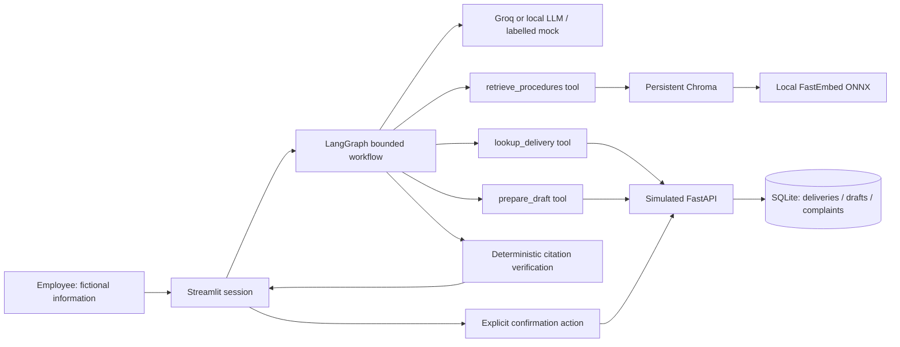

# Architecture and trust boundaries

## Responsibilities

`coordinator` is a deterministic workflow node. The UI selects procedure or complaint mode;
the coordinator validates operational scope, country ambiguity, and missing fields. It is
not described as an autonomous agent. This makes routing easy to inspect in an interview.

The model-driven tool decision node plays the knowledge or complaint agent role depending
on the selected workflow. It selects an allowed tool and a retrieval query using a Pydantic
structured response. The knowledge agent then selects exact supporting sentences from
retrieved passages in a second structured response. The complaint agent chooses lookup,
retrieval, or preparation; it never invents delivery attributes or required complaint values.
The form supplies these values and the API supplies the country. These are constrained
agents, not independent background workers. Mock mode simulates their decisions deterministically.

LangChain `@tool` objects have validated input schemas. `tools` is a deterministic dispatcher;
it enforces preconditions and runs only allowlisted calls. `verification` is deterministic:
every displayed claim must reference a retrieved chunk and be an exact substring of it.
Failed verification produces an explicit insufficient-evidence response with no displayed claims.
It cannot prove that an excerpt is relevant, complete, correct, or safe in the real world.

The UI language selector supports English and Bulgarian. Bulgarian questions are mapped to English
retrieval queries by the model because the corpus/embedding model are English. Responses can include
Bulgarian machine translations alongside the unchanged original quoted evidence. Verification checks
the original quote, not translation fidelity; translations are explicitly labelled for review.

At most four tool selections, a recursion limit of 16 supersteps, a 25-second model request
timeout, a five-second HTTP client timeout, bounded response tokens, and zero provider retries
keep execution finite. The normal procedure path uses one tool; a normal complaint uses three.
No hidden reasoning is shown. Activity traces contain only observable steps and outcomes.

## RAG pipeline

Seven versioned Markdown files contain JSON metadata between `---` delimiters. LangChain
Documents preserve document ID, title, country, effective date, status, section, and version.
Section-aware processing uses `RecursiveCharacterTextSplitter` within sections, with 900-character
chunks and 100-character overlap. Chunk IDs hash section, position, and text under the document
ID/version; IDs remain stable for unchanged source material.

FastEmbed maps passages and queries into the same semantic vector space locally. Chroma
persists vectors in an embedded store, without another service. A content-addressed collection
and atomically replaced manifest select each completed corpus build. Previous builds are not
used after a successful rebuild. There is no silent keyword fallback.

Chroma applies country (`GLOBAL` or selected country), current status, and effective-date
filters before returning nearest chunks. Superseded documents are always excluded, including
historical queries: this demo does not reconstruct historical version validity intervals.
Country supplements complement global procedures; the seed corpus avoids conflicting rules.
A real policy system would need explicit precedence and contradiction handling.

Retrieval returns up to three chunks within a heuristic cosine distance cutoff. The model
may abstain even when chunks were retrieved. Evaluation reports retrieval ranking independently
from answer-quality review, and never converts vector distances into confidence percentages.

## API and confirmation

The Streamlit UI and graph use `BusinessClient` over HTTP; only the FastAPI application owns
SQLite. GET `/deliveries/{id}` reads seeded fictional records. PUT `/drafts/{id}` validates the
fields, delivery country, package count, and monotonic revision. The UI previews the saved draft.
Only an explicit checkbox plus submission button calls POST `/complaints`.

The canonical sorted draft JSON is SHA-256 fingerprinted. The POST includes the revision,
fingerprint, explicit confirmation, and an idempotency key equal to that fingerprint. A changed
server draft rejects old confirmation. UI field changes disable submission until the updated
draft is saved and reviewed. A SQLite `BEGIN IMMEDIATE` transaction and unique draft/key
constraints serialize concurrent retries, returning the same reference for repeated submissions.
Submitted drafts are immutable. This is a local application guard, not cryptographic proof of
human consent or a production authorization scheme.

## Trust boundaries and tradeoffs

- User input, documents, and model/tool outputs are untrusted data. Structured schemas reject
  extra fields and invalid values. Delivery data is validated by the client and API.
- Model output never sets network destinations, delivery IDs for side effects, SQL, file paths,
  shell commands, or submission authorization. Parameterized SQL protects database operations.
- Retrieved text is given to the answer model as JSON data, never used to grant tools. Known
  injection patterns are excluded as an additional heuristic; novel attacks can evade this.
- Only fictional content leaves the process for Groq inference. Embeddings stay local. Secrets
  come from environment variables / ignored `.env`; raw error objects and conversations are not
  logged. Intentional evaluation outputs are local ignored files.
- Per-user conversational data lives in Streamlit session state. Each graph is created for
  one execution, so its request-scoped closure is not shared between sessions.
- SQLite is proportional to this local demo. Chroma adds a maintained persistent vector store;
  FastAPI demonstrates an integration boundary without deployment infrastructure. LangChain
  and LangGraph are used for actual documents/tools/models and bounded orchestration.
- Authentication, distributed transactions, production observability, deployment, large-corpus
  retrieval, broad intent recognition, and regulatory validation are explicit gaps.
