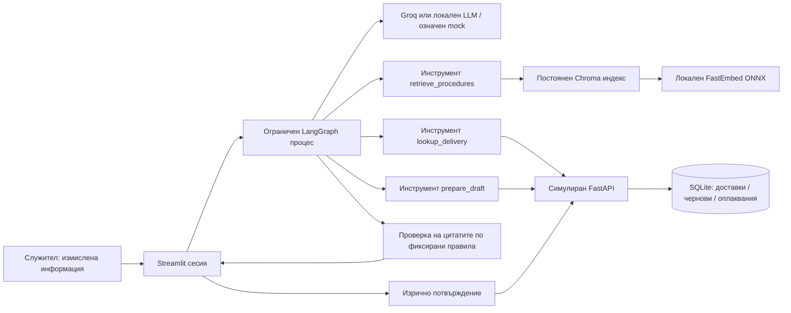

# Архитектура и граници на доверие

[English](../architecture.md) | [Български](architecture.md)

## Отговорности

`coordinator` е възел с поведение по фиксирани правила. Интерфейсът избира режим за въпроси
по процедури или за оплаквания; координаторът проверява обхвата, неясната държава и липсващите
полета. Той не е автономен агент. Така маршрутизирането е лесно за обяснение на интервю.

Възелът, в който моделът избира инструмент, изпълнява ролята на агент за знания или агент за
оплаквания според избрания процес. Избира разрешен инструмент и заявка за търсене чрез
структуриран Pydantic отговор. След това агентът за знания избира точни подкрепящи изречения
от извлечените откъси във втори структуриран отговор. Агентът за оплаквания избира справка
за доставка, извличане или подготовка; не измисля характеристики на доставка или задължителни
стойности за оплакването. Формулярът предоставя тези стойности, а API — държавата. Това са
ограничени агенти, а не независими фонови изпълнители. Mock режимът симулира решенията им по фиксирани правила.

LangChain `@tool` обектите имат проверявани входни схеми. `tools` е възел за изпълнение по
фиксирани правила: налага предварителните условия и допуска само изрично разрешени извиквания.
`verification` също е детерминистичен: всяко показано оригинално твърдение трябва да сочи
извлечен откъс и да е точен подниз на съдържанието му. При неуспешна проверка се връща
изричен отказ поради недостатъчни доказателства, без показване на твърдения. Това не доказва,
че откъсът е релевантен, пълен, верен или безопасен в реална среда.

Превключвателят за език поддържа английски и български. Моделът преобразува българските
въпроси в английски заявки за търсене, защото корпусът и embedding моделът са на английски.
Отговорите могат да съдържат български машинен превод заедно с непроменените оригинални цитати.
Проверката обхваща оригиналния цитат, а не точността на превода; преводите са ясно означени за преглед.

Най-много четири избора на инструмент, recursion limit от 16 стъпки на графа, timeout от
25 секунди за моделна заявка, timeout от пет секунди за HTTP клиента, ограничен брой изходни
токени и нула автоматични повторения към доставчика правят изпълнението крайно. Обичайният
процес за процедура използва един инструмент, а оплакването — три. Не се показват скрити
разсъждения. Списъкът с действия съдържа само наблюдаеми стъпки и резултати.

## RAG процес

Седем Markdown файла с версии съдържат JSON метаданни между разделители `---`. LangChain
Documents запазват идентификатор, заглавие, държава, дата на влизане в сила, статус, раздел и
версия. Разделянето използва `RecursiveCharacterTextSplitter` вътре в разделите: откъси с
размер 900 знака и застъпване 100 знака. Идентификаторите се получават чрез хеш на раздела,
позицията и текста, комбиниран с идентификатора и версията на документа. Непроменен източник
запазва същите идентификатори.

FastEmbed преобразува откъси и заявки в едно и също семантично векторно пространство локално.
Chroma съхранява векторите в локално вградено хранилище без допълнителна услуга. Колекция,
идентифицирана по съдържанието, и атомично заменен manifest файл избират завършеното
изграждане на корпуса. След успешно обновяване старите колекции не се използват. Няма
скрито заместване с търсене по ключови думи.

Chroma прилага филтри за държава (`GLOBAL` или избраната държава), текущ статус и дата на
влизане в сила преди връщане на най-близките откъси. Заменените документи винаги се изключват,
включително при исторически заявки: демото не възстановява исторически интервали на валидност.
Държавните допълнения допълват глобалните процедури; примерният корпус избягва противоречиви
правила. Реална система би изисквала изричен приоритет и обработване на противоречия.

Извличането връща до три откъса в рамките на евристичен праг за косинусово разстояние.
Моделът може да откаже отговор дори при намерени откъси. Оценката на подреждането на
източниците е отделна от прегледа на качеството на отговорите. Векторните разстояния никога
не се представят като процент увереност.

## API и потвърждение

Streamlit интерфейсът и графът използват `BusinessClient` през HTTP; само FastAPI управлява
SQLite. GET `/deliveries/{id}` чете примерните измислени записи. PUT `/drafts/{id}` проверява
полетата, държавата на доставката, броя пакети и последователното увеличаване на версията.
Интерфейсът показва запазената чернова. Само изрично маркиране на полето за преглед и натискане
на бутона за подаване извикват POST `/complaints`.

Каноничният JSON на черновата с подредени ключове се хешира със SHA-256. POST включва версията,
хеша, изрично потвърждение и idempotency key, равен на хеша. Променена сървърна чернова отхвърля
старото потвърждение. Промени във формуляра изключват подаването, докато обновената чернова не
бъде запазена и прегледана. SQLite транзакция `BEGIN IMMEDIATE` и уникални ограничения за
чернова и ключ подреждат едновременните опити и връщат един и същ референтен номер при
повторно подаване. Подадените чернови не могат да се променят. Това е локална програмна
защита, а не криптографско доказателство за човешко съгласие или production схема за права.

## Граници на доверие и компромиси

- Потребителският вход, документите и изходите на модели и инструменти са недоверени данни.
  Структурираните схеми отхвърлят допълнителни полета и невалидни стойности. Данните за
  доставки се проверяват и от клиента, и от API.
- Моделът не задава мрежови адреси, идентификатори за действия с промяна на данни, SQL,
  файлови пътища, shell команди или разрешение за подаване. Параметризираният SQL защитава базата.
- Извлеченият текст се подава като JSON данни на модела за отговор, а не като разрешение за
  инструменти. Познати шаблони на злонамерени инструкции се изключват допълнително;
  нови атаки могат да избегнат тази евристика.
- Само измислено съдържание се изпраща към Groq. Embeddings остават локални. Тайните идват
  от променливи на средата / изключен `.env`; сурови грешки и разговори не се записват в логове.
  Нарочно създадените оценъчни отчети са локални файлове, изключени от Git.
- Разговорите са в Streamlit session state. За всяко изпълнение се създава нов граф, така че
  контекстът на една заявка не се споделя между потребителски сесии.
- SQLite е достатъчен за размера на локалното демо. Chroma предоставя поддържано постоянно
  векторно хранилище; FastAPI показва интеграционна граница без инфраструктура за внедряване.
  LangChain и LangGraph се използват реално за документи, инструменти, модели и ограничена оркестрация.
- Изрично липсват удостоверяване, разпределени транзакции, production наблюдаемост, внедряване,
  извличане от големи корпуси, широко разпознаване на намерения и нормативна валидация.
